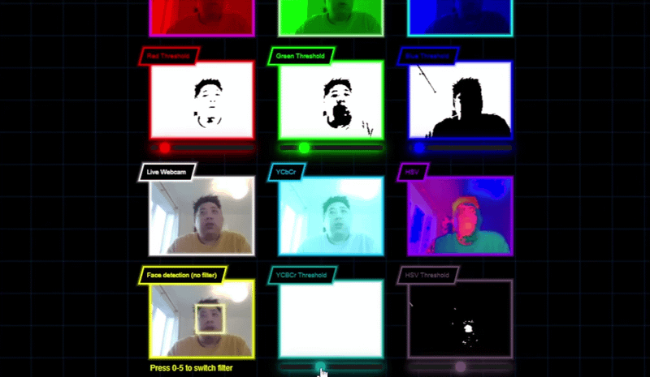
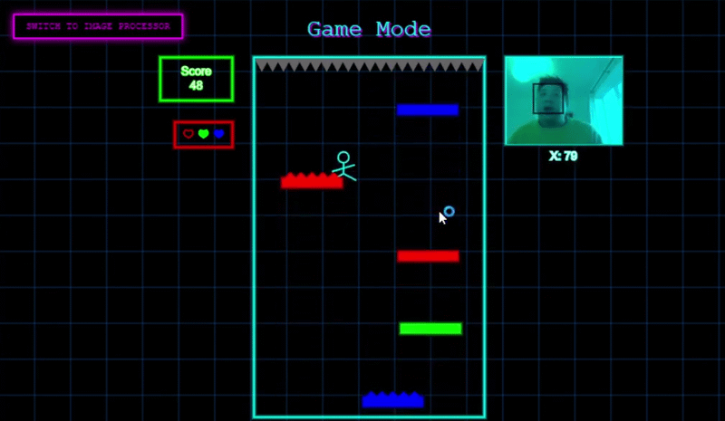

# Real-Time Vision Engine & Face-Controlled NS-Shaft

> A BSc Computer Science Graphics Programming project combining real-time webcam colour space processing (`RGB`, `YCbCr`, `HSV`), interactive thresholding, and a face-tracked arcade game built with `p5.js`.

   

## 💡 Overview

Developed for a university **Graphics Programming** module, this project explores real-time pixel manipulation, colour space conversions, and face detection directly in the browser. It is divided into two main parts: a real-time **Vision Engine** for comparing thresholding behaviour across different colour spaces, and an interactive **NS-Shaft** game extension controlled entirely by the player's face position.

---

## 🔍 Part 1: Vision Engine — Colour Spaces & Thresholding

This module processes live webcam feeds to demonstrate how different colour space models affect brightness isolation, noise levels, and thresholding stability when adjusted via an interactive slider.



### Key Technical Breakdown

- **RGB Channel Thresholding (Luminance Ratios):** Implements channel-specific thresholding based on human visual luminance weights (**Red: 29.9%**, **Green: 58.7%**, **Blue: 11.4%**). Adjusting the threshold slider clearly illustrates how brightness distribution differs across channels—most noticeably in the blue channel.
- **Linear vs. Non-Linear YCbCr:** By separating luminance (`Y`) from chrominance (`Cb`, `Cr`), YCbCr isolates grayscale brightness information and significantly reduces noise compared to raw RGB. While non-linear YCbCr can boost brightness, it shifts the tonal range heavily toward the bright end, causing overly abrupt jumps when moving the threshold slider. I opted for **Linear YCbCr** to preserve smooth, predictable slider sensitivity across the `120/255` to `200/255` range.
- **HSV Comparison:** Tested HSV as an alternative colour space. Because its Value (`V`) channel incorporates raw RGB colour intensity—and Hue (`H`) / Saturation (`S`) are highly sensitive to minor RGB fluctuations—HSV introduced noticeable speckles and false edges under uneven lighting, making it less stable for thresholding than YCbCr's pure luminance channel.

---

## 🎮 Part 2: Extension — Face-Controlled NS-Shaft

Inspired by the classic falling arcade game **NS-Shaft**, this extension replaces traditional keyboard inputs with real-time **face-position tracking**, allowing players to steer their character by moving their head left and right.



### Gameplay Mechanics

- **RGB Health System:** The player starts with three hearts, each representing an **R, G, or B** colour channel. Landing on spikes strips away a corresponding colour, while landing on a matching colour platform restores it. Losing all three colours results in Game Over.

### Engineering Challenges & Optimizations

- **Reducing Detection Latency:** The initial prototype used `ml5.js`, which provided solid recognition but introduced severe frame lag. To keep gameplay responsive, I migrated to a lightweight object detector provided for the coursework.
- **Frame-Budget & Filter Pipeline Optimization:** Applying face filters every frame initially exceeded the per-frame execution budget in `p5.js`. I improved performance by tuning the frame rate, simplifying the algorithm, and restructuring the pipeline to apply the active image filter first and crop the detected face region directly.
- **Dedicated Webcam Streams per Mode:** Running heavy image processing alongside game logic caused noticeable stuttering. Assigning each mode its own dedicated webcam instance decoupled the workloads and significantly improved the user experience.
- **Graceful UX Fallback (Grayscale Indicator):** Because real-time face detection is not 100% immune to tracking dropouts, losing control unexpectedly can confuse players. Whenever face tracking fails, the game automatically applies a **grayscale filter**—giving instant visual feedback that the player needs to reposition their face, while turning a hardware limitation into an engaging gameplay twist.

---

## 🚀 How to Run Locally

**Prerequisites:** Visual Studio Code with the **Live Server** extension installed, plus a working webcam.

1. Clone the repository:
   ```bash
   git clone https://github.com/jeremyf2020/vision-engine-ns-shaft.git
   ```
